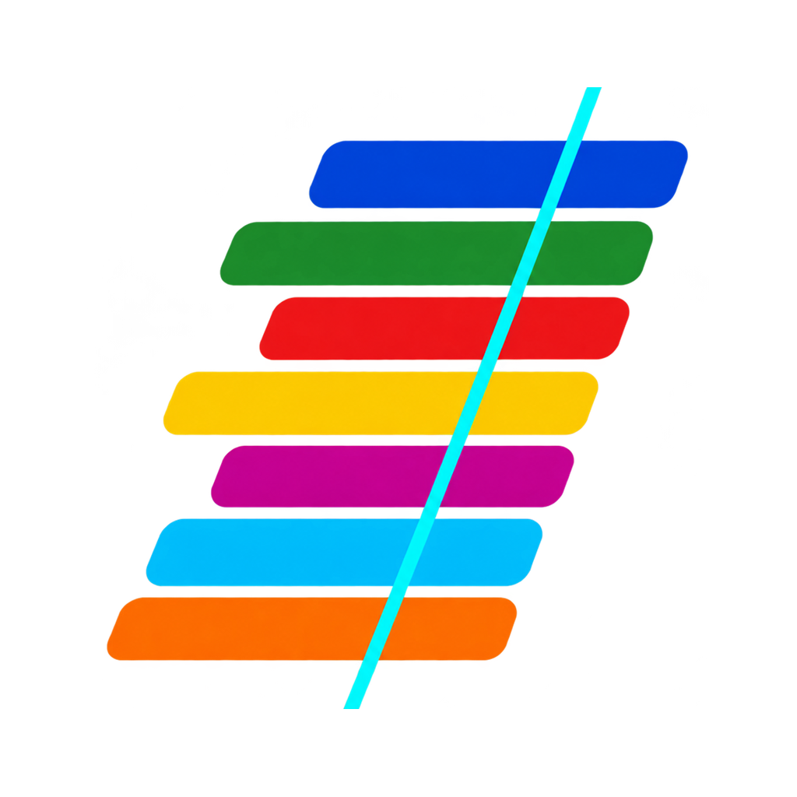

<p align="center">
  
</p>

<h1 align="center">Scorewall</h1>

<p align="center">
  ICPC 赛场大屏的网页实现 · 九个画面 · 零构建
</p>

<p align="center">
  <a href="#部署"></a>
  <a href="#部署"></a>
  <a href="#画面"></a>
</p>

---

**Scorewall** 把 [ICPC Tools](https://github.com/icpctools/icpctools) 那套赛场大屏视觉搬到了浏览器里。

尺寸、颜色、字号、动画曲线全部从上游 Java 源码抄——不自己设计。

---

## 为什么不用 ICPC Tools

ICPC Tools 是 Java2D 应用，实际用下来坑很固定：

| 坑 | 现象 |
|---|---|
| 换画面要重启进程 | 黑屏 30~40 秒 |
| `--display` 是「编号+模式字母」 | 写成 `1x` 会把 1280×720 的屏切成 4K，布局算出负数宽高 |
| 图片按 URL 缓存 | 换 logo 必须清 `%TEMP%\org.icpc.tools.cache.*` |
| 中文字体 | 必须设 `ICPC_FONT=DengXian`，否则全方块 |
| 一个进程只能一个画面 | 左右分屏要开两个进程 |

网页版把这些全部绕开：切视图是瞬时的，分屏是 CSS，字体随便挂。

---

## 画面

九个视图，`?view=<名字>` 直接访问：

| 视图 | 内容 | 上游对应 |
|---|---|---|
| `standings` | 实时榜单，12 行分页 | `AbstractScrollingScoreboardPresentation` |
| `judge` | 判题队列，滑入/停留/淡出 | `JudgePresentation` |
| `countdown` | 大倒计时 + 工位状态滑块 | `StatusCountdownPresentation` |
| `polar` | 圆环倒计时（赛末用） | `PolarCountdownPresentation` |
| `problems` | 单题统计色块 | `ProblemSummaryPresentation` |
| `chart` | 题目柱状图（提交/通过） | `ProblemSummaryChart` |
| `fts` | First to Solve 首杀榜 | `FirstToSolvePresentation` |
| `tilerank` | 每队一个方块的排名 | `TeamTileHelper` |
| `timeline` | 每队过题时间轴 | `TimelinePresentation` |

---

## 轮播

按比赛阶段自动切换，不需要 OBS 场景。

```
赛前（还没开始）      countdown                      钉住
赛中（进行中）        standings,fts,problems,
                      tilerank,chart                 轮播
赛末（剩 30 分钟内）  polar                          钉住
赛后（已结束）        standings                      钉住
```

**`?rotate=auto`** 每个视图演完自己那一轮再切，一轮的长度由视图自身决定：

| 视图 | 一轮 |
|---|---|
| `standings` | 屏数 × 12s + 4s（淡入停留淡出） |
| `problems` | (题数+1) × 1s + 5s |
| `chart` | 15s（`AbstractChartPresentation.getRepeat()`） |
| `tilerank` | `tileRepeat()` 滚动一轮 |

`?rotate=25` 也能固定秒数，但不会超过视图自身周期——否则会重播（chart 的柱子归零再长一遍）。

**自定义阶段**：

```
?before=countdown,polar
&during=standings,judge,problems
&final=countdown
&after=standings
&finalMin=30
```

---

## 远控

OBS 里填好地址就不用管了，切换都在手机上点：

```
https://你的域名/control
```

- **比赛阶段**：赛前 / 赛中 / 赛中后期 / 赛后 / 自动
- **工位状态**：九个工位逐个切 0（未就绪）/ 1（待定）/ 2（就绪）
- **直接切视图**：绕过轮播，钉在某个画面上

大屏每 2 秒轮询一次，点完就跟着变，不用刷新。

---

## 配置页

```
https://你的域名/scorewall/config.html
```

按视图分组，改完实时预览生成的 URL：

- 数据源地址 + 连通检测
- 行数、校徽开关、题目配色
- 判题队列停留时长、未判超时
- 轮播各阶段的视图列表

---

## 部署

零构建，静态文件即可。`src/` 整个目录扔到 nginx 后面就行。

**需要**：一个实现 CCS Contest API 的数据源。我们用 [nowcoder-bridge](https://github.com/Yunlk/nowcoder-bridge) 把牛客的比赛转成 CCS 格式。

```
GET /api/contests/<id>                       比赛元信息
GET /api/contests/<id>/event-feed            NDJSON 事件流
GET /api/contests/<id>/teams|problems|…
```

`?src=http://host/api/contests/<id>` 指定数据源；同源托管时适配器会注入默认值，不用手填。

**本地跑**：

```bash
node test/serve-fixtures.mjs      # http://127.0.0.1:8090
```

夹具自带实时模拟：每 3 秒一条提交，判题机串行判题，能看到判题队列完整动画。

---

## URL 参数

| 参数 | 说明 |
|---|---|
| `src` | CCS 数据源 |
| `view` | 固定视图 |
| `rotate` | `auto` 或秒数，轮播间隔 |
| `phase` | 锁定阶段，覆盖时间判定 |
| `sites` | `0` 关闭工位状态 |
| `rows` | 每屏行数，默认 12 |
| `logo` | `0` 关闭校徽 |
| `freeze` | 封榜时长 |
| `debug` | `1` 显示调试信息（收包数、队列状态、轮播列表） |

---

## 结构

```
src/
  index.html            入口，只引 app.js
  board.css             布局 + 字体（ICPC 自带 Helvetica）
  app.js                主循环、数据同步、视图分发、轮播、远控
  scoring.js            榜单计算、一血、时间格式化
  state.js              事件模型（applyEvent）
  *-canvas.js           九个视图，每个对应一个 Java presentation
  judge-queue.js        判题队列状态机 + Animator/Movement
  digital-font.js       七段数字字体
  team-logo.js          校徽加载与缩放
  config.html           配置页
  control.html          远控页
test/
  serve-fixtures.mjs    假 CCS 服务 + 实时模拟
  *.test.mjs            单元测试
docs/
  presentation-constants.md   从源码扒的全部数值
  pitfalls.md                 对接 CCS 踩过的坑
```

---

## 已知差异

对比上游，这几处是有意为之：

- **`% 48` 去掉了**。源码 `getTime()` 里对小时取模 48（假设比赛不超过两天），但开放好几天的练习赛 duration 能到 131 小时，`62:42` 会被显示成 `14:42`。
- **未判超时可配**。源码信任数据源一定会给 judgement，但实际会遇到永远不判的提交，堵住队列第一行。默认 120 秒后自动淡出，`?pendingMax=0` 恢复源码行为。

---

## 参考

- [ICPC Tools](https://github.com/icpctools/icpctools) — 视觉基准
- [CCS Contest API](https://ccs-specs.icpc.io/) — 数据格式
- [nowcoder-bridge](https://github.com/Yunlk/nowcoder-bridge) — 牛客转 CCS

## 许可

待定。
